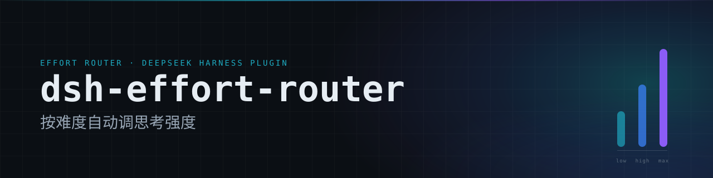
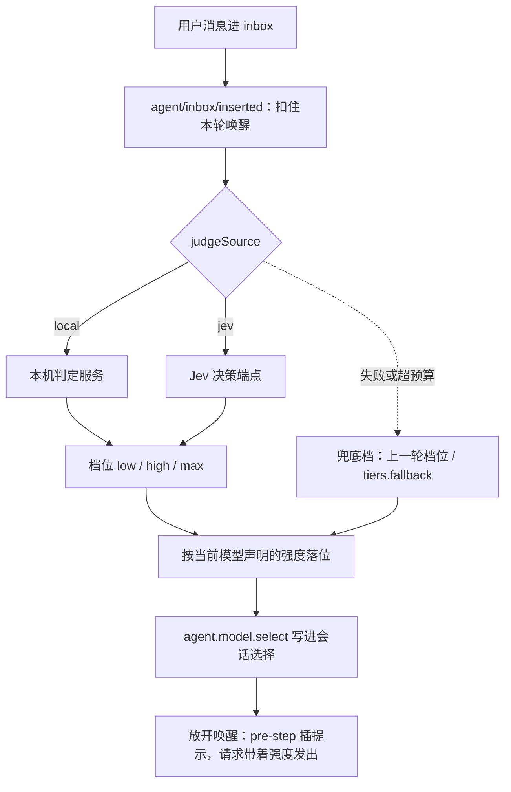

<p align="center">
  
</p>

<p align="center">
  
  
  
  
</p>

<p align="center">
每轮按任务难度自动选择思考强度，<code>provider</code> 和 <code>model</code> 保持你在模型选择器里的选择。<br>
<sub>Per-turn reasoning effort routing for DeepSeek Harness.</sub>
</p>

## 它做什么

你按下发送后，插件把这轮的文本交给判定源，换回一个档位：`low`、`high`、`max`。档位按当前模型在 Provider 里声明的强度列表落位，写进本轮请求的 `reasoningEffort`。

判定在请求发出之前跑完，所以本轮第一个请求就带着新强度。

判定源不可用、超出预算、或者目标模型没有声明强度时，插件落一个兜底档（该会话上一轮的档位，没有就用 `tiers.fallback`），请求照常发出。

## 为什么需要它

同一个模型，问一句“今天几号”和让它重构三个文件，值得花的思考预算不一样。手动去模型选择器里调，容易忘记调回来，换个模型又要重新试。

这个插件把这一步放进每轮请求：难度判一次，强度自动落位，档位变化在输入框旁边就能看到。

## 核心能力

- 每轮判一次，判的是这一轮的用户消息。
- `provider` 和 `model` 用模型选择器里的那个，换厂商不用改插件。
- 档位按模型声明的强度列表按位置落位，各厂商的档位都能用满。
- 判定源可选：本机 Python 判定服务，或 Jev 的 System One 决策端点。
- 输入框右侧的芯片显示上一轮与这一轮的档位，悬停能看到最终强度与模型名。
- 判定结果落盘到 `~/.dsh/router-effort/last.json`，重启 DSH 后芯片仍有内容。
- 你在模型选择器里手动调过强度时，判定结果只往上抬，比你的选择弱就保留你的选择。

## 工作流程



DSH 0.2.2 的时序决定了写入点：

```
send() → splice → agent/inbox/inserted（同步）→ runMaintenance 扣住唤醒
                                                       ↓ 判定 + model.select
放开唤醒 → wakeDriver → inbox.claim → model.current() 快照 → agent/pre-step → 请求
```

`model.current()` 的快照发生在 `pre-step` 派发之前。写在 `pre-step` 里的强度只影响下一步，所以判定放在 `inserted` 里跑，用 `runMaintenance` 把唤醒扣到写完为止。

## 首 token 延迟

判定跑在 hold 里，这段等待直接落在本轮首 token 上。Jev 端点的实测（4000 字符任务文本、真实 criteria，20 次成功样本）：

| 口径 | p50 | p90 | max |
| --- | --- | --- | --- |
| 真实请求体（20 次） | 964ms | 1371ms | 1737ms |
| 全部成功样本（50 次） | 964ms | 1591ms | 2416ms |

50 个样本里没有超过 3000ms 的，所以 Jev 分支的判定预算默认 3000ms；本机判定服务在同机旁，默认 1200ms。两者都可以用 `judgeTimeoutMs` 改。

超出预算时按兜底档放行，这一轮多等的就是预算那么多。

## 安装

运行环境：Node.js 18 以上，DSH 0.2.2-rc.1 以上。

### GUI

设置里的插件管理，安装框填：

```
github:Hakutaku-02/dsh-effort-router
```

装完重启 DSH。包里的 `cordis.patch.yml` 在启动时插入配置行，装完即启用。

### 命令行

```bash
dsh plugin --profile web install github:Hakutaku-02/dsh-effort-router
```

`--profile` 必填。`desktop` profile 由 Electron 应用独占，桌面端只能用 GUI 安装。

### 判定服务

`judgeSource` 为 `local` 时，首次启动发现判定服务不在线，插件会在后台部署：建 venv、装 CPU 版 torch、下载 846 MB 权重、拉起服务。需要 Python 3.10 到 3.13，磁盘约 2 GB，能访问 PyPI 与 HuggingFace。冷启动加载权重约 70 秒。

部署期间请求照常发出，那几轮落兜底档。装好之后状态会自己回到 `up`，不用重启。

不想自动下载就把 `provision` 设为 `false`；下载慢可以设 `HF_ENDPOINT` 换镜像。

`judgeSource` 为 `jev` 时不检查本机服务，也不部署。

## 装好之后

输入框右侧多出一个芯片。还没判定过时显示 `Default`；有记录后显示上一轮到这一轮，同档是 `high → high`，跨档是 `low → high`。悬停或读屏能看到 `当前档 → 强度（provider/model）`。

设置左侧导航多出一节「思考强度」，插件详情页里也有一份同样的配置，改哪边都一样。

## 档位怎么落位

判定只给三档，插件看当前模型自己声明了哪些强度，然后按位置取：`low` 取第一档，`high` 取中间档，`max` 取最后一档。

| 模型 | 声明的强度 | 判定 low | 判定 high | 判定 max |
| --- | --- | --- | --- | --- |
| deepseek-v4.1-flash | low / high / max | low | high | max |
| minimax-m3.1-flash | low / medium / high / xhigh / max | low | high | max |
| gemini | low / medium / high | low | medium | high |

想手工指定落点就改 `tiers`，只要它与默认值不同，插件就按那张表走。

## 判定源

`judgeSource` 二选一。

**local** 走本机判定服务，默认地址 `http://127.0.0.1:8765/judge`。协议固定：`POST` 任务描述，返回 `{"tier":"low|high|max"}`；`GET /health` 返回 `{"protocol":"finetuned"}`。

**jev** 走 System One 决策端点，默认 `https://api.typesafe.ai/v1/systemone`。协议是 `{model, state, questions}` → `{answers:{effort:{choice, confidence, probabilities}}}`。Key 在设置页的 API Key 输入框里填，凭据引用名默认 `TYPESAFE_API_KEY`；先查宿主凭据库，再查进程环境变量；超时 12 秒。置信度低于 `jevConfidence` 时，在概率最高的两档里取更强的那个。

Jev 的地址与 Key 要配套：`https://api.typesafe.ai/v1/systemone` 配 TypeSafe 发的 Key，`https://tokenflux.dev/v1/systemone` 配 TokenFlux 发的 Key。拿错会得到 401。

`jevModel` 只能填端点允许的模型名。`tokenflux.dev` 上是 `jev-latest` 与 `jev-preview`；填 `jev-1.14.0` 会被拒（403 `permission_error`），每轮白花一次往返。响应里的 `model` 字段会归一成 `jev-1.14.0`，档位判定不受影响。

local 判定在本机完成，任务描述不出本机；jev 会把任务描述发给上面配置的端点。

## 设置页

| 区块 | 能改什么 |
| --- | --- |
| 路由开关 | 开启或关闭。关掉后不改请求 |
| 判定方式 | 本地服务或 Jev，选 Jev 时展开下面四项 |
| Jev 配置 | 地址、模型名、API Key、置信度阈值。Key 存进凭据库，面板只显示已配置或未配置 |
| 模式 | 自动或手动。手动时强度由你在模型选择器里定，与总开关叠加 |
| 判定服务 | 本机判定服务的地址 |
| 对话提示 | 变化时提示、每轮都提示、不提示 |
| 档位映射 | 简单、中等、困难、兜底四个下拉 |

页面行为：

- 没有改动时「保存」是灰的，改动后才可点；只填 Key 不动其他字段也能保存。
- 判定地址、Jev 地址、模型名必填。清空后保存只给提示，不发请求。
- 置信度留空或超出 0 到 1 也不保存。
- Key 输入框不回显已有值，留空表示不改。
- 「测试」按表单里当前的判定源与模型名发一次最小请求，地址用已保存的值；改过地址要先保存再测。
- 档位下拉只列真实档位，不含 `off`。

<details>
<summary>配置字段与默认值</summary>

| 字段 | 默认值 | 作用 |
| --- | --- | --- |
| `enabled` | `true` | 总开关。`false` 时不改请求 |
| `mode` | `auto` | `manual` 时不改请求，与总开关叠加 |
| `judgeSource` | `local` | 判定后端，`local` 或 `jev` |
| `judgeUrl` | `http://127.0.0.1:8765/judge` | 本机判定服务地址 |
| `judgeTimeoutMs` | local `1200` / jev `3000` | 一次判定的预算，也是首 token 最多晚多久 |
| `jevUrl` | `https://api.typesafe.ai/v1/systemone` | Jev 决策端点 |
| `jevModel` | `jev-latest` | Jev 模型名 |
| `jevApiKeyEnv` | `TYPESAFE_API_KEY` | 凭据引用名，面板保存 Key 时也写这里 |
| `jevConfidence` | `0.6` | 置信度阈值 |
| `jevTimeoutMs` | `12000` | 设置页「测试」按钮的 Jev 请求超时 |
| `tiers` | `low/high/max` 同名映射，`fallback: low` | 档位到强度的映射 |
| `notify` | `''`（变化时提示） | 提示频率 |
| `autoStart` | `true` | 发现本机判定服务不在线时按路径拉起 |
| `servicePython` | 空 | 判定服务的 Python 路径 |
| `serviceScript` | 空 | 判定服务的入口脚本 |
| `provision` | `true` | 本机判定服务起不来时自动部署 |
| `layaDir` | 空 | `dsh-router-laya` 包的位置 |
| `startupWaitMs` | `3000` | 启动时等本机判定服务就绪的上限 |
| `startWaitMs` | `90000` | 拉起后等就绪的上限，覆盖约 70 秒冷启动 |
| `provisionWaitMs` | `5000` | 部署脚本跑完后等就绪的上限 |
| `modelInfoTtlMs` | `60000` | 模型档位的缓存寿命 |

保存写回 profile 的 `cordis.patch.yml`。`enabled`、`mode`、`judgeSource`、`judgeUrl`、`notify`、`tiers`、`jevUrl`、`jevModel`、`jevApiKeyEnv`、`jevConfidence`、`judgeTimeoutMs` 改完即时生效，其余字段下次重启生效。

</details>

<details>
<summary>HTTP 接口</summary>

路径都带 `/router-effort/*` 旧别名，下表只列新路径。端口用当前 GUI 的端口。

| 路径 | 方法 | 作用 |
| --- | --- | --- |
| `/effort-router/judge` | GET | 判定后端状态：`{backend, state, detail, judgeUrl}`，local 时另带 `setupLog`，jev 时另带 `jevModel` |
| `/effort-router/config` | GET / POST | 读配置、写配置 |
| `/effort-router/mode` | GET / POST | 读当前模式、切自动或手动 |
| `/effort-router/models` | GET | 查看某个模型解析到的强度与落点 |
| `/effort-router/last` | GET | 芯片的数据源，按会话返回最近一次判定 |
| `/effort-router/seen` | GET / HEAD | 前端报到，记录会话与组件参数 |
| `/effort-router/probe` | POST | 设置页「测试」按钮的后端 |
| `/effort-router/key` | GET / POST | 查 Jev Key 状态、写入 Key |
| `/effort-router/open-credentials` | POST | 用系统默认程序打开 `.credentials.yaml` |

`POST` 一律要求 `Content-Type: application/json`。

```bash
curl "http://127.0.0.1:<GUI 端口>/effort-router/models?provider=<provider>&model=<model>&tier=max"
# {"efforts":["low","medium","high"],"tier":"max","picked":"high","ttlMs":60000}
curl "http://127.0.0.1:<GUI 端口>/effort-router/judge"
# {"backend":"jev","state":"up","detail":"","judgeUrl":"https://tokenflux.dev/v1/systemone","jevModel":"jev-latest"}
```

</details>

## 已知限制

- 判定服务（local）的请求与响应格式写死，换别的判定服务要改代码。
- 强度排序按名字：`off` < `minimal` < `low` < `medium` < `high` < `xhigh` < `max`。厂商出现新词时要补进代码，否则那个强度会被跳过。
- 一轮只判一次，中途追加的长任务不会重新判。
- 子代理不单独判定，强度跟主代理走。
- 判定在请求前跑完，首 token 会晚一次判定的时间：Jev 通常 1 秒上下，预算是 3000ms。
- 模型选择器里的「推理等级」会跟着判定跳，这份选择就是请求的来源。你手动改过的等级作为下限，插件只往上取，不会降到它下面。
- 每轮判定都会 append 一条 `model/selection`，值不变时宿主会短路，实际增量很小。
- 目前只在 Windows 上验证过。
- 改了 `client.js` 要刷新窗口才看得到，宿主侧改动要重启 DSH。

## 开发

```bash
npm test            # 10 个测试文件，不联网
npm run test:cordis # 在真 cordis 上下文里跑挂载与事件
```

测试不读 `node_modules`，克隆下来直接跑 `npm test` 就行。`@deepseek-ai/schemastery` 由 profile 提供；`npm install` 会装上 `dsh-router-laya`，部署判定服务时用它。CI 跑 Node 20、22、24。

```
.
├── index.js           宿主侧：判定、落位、部署、路由
├── client.js          前端：设置页与输入框芯片
├── assets/            README 用的 banner
├── locale/            插件列表里的标题与描述
├── test/              单元测试，不依赖网络；fake-host.mjs 是 0.2.2 时序的测试替身
└── cordis.patch.yml   默认挂载行
```

## 许可证

MIT，见 [LICENSE](LICENSE)。
