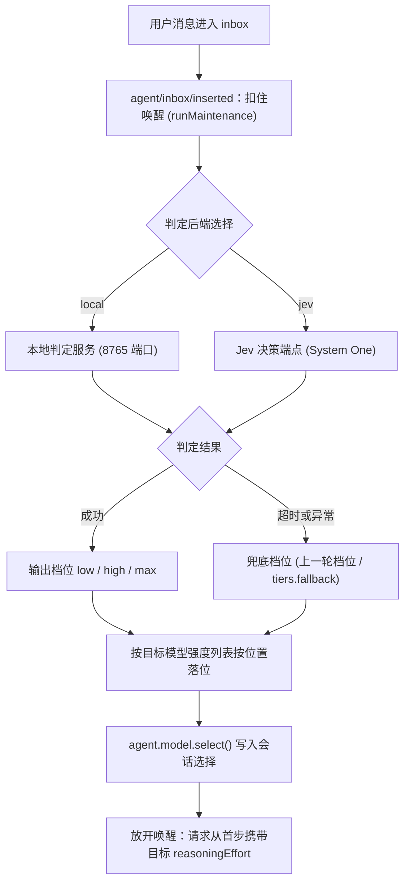

<p align="center">
  
</p>

<p align="center">
  
  
  
  
</p>

<p align="center">
按任务难度自动匹配当前模型的思考强度，保持 Provider 与模型选择不变。<br>
<sub>Per-turn reasoning effort routing for DeepSeek Harness.</sub>
</p>

## 它做什么

用户发送消息后，插件抓取当轮文本判定难度，输出 `low`、`high`、`max` 三个档位。

档位按当前模型在 Provider 中声明的思考强度列表（按位置）落位，并写入当轮请求的 `reasoningEffort`。

**时序保障**：在 DSH 0.2.2 时序下，消息进入 inbox 时触发 `agent/inbox/inserted` 事件。插件通过 `agent.runMaintenance` 挂起唤醒并执行异步判定，调用 `agent.model.select()` 写入配置。放开唤醒后，首个请求直接携带计算出的思考强度。

**兜底机制**：判定超时、服务异常或目标模型未声明强度时，自动采用兜底档位（优先使用会话上一轮档位，若无则使用 `tiers.fallback`），保障会话流程顺畅发出。

**手动下限**：用户在模型选择器中手动设定的强度作为保护下限，自动判定只提升不降低。

## 为什么需要它

不同任务对思考深度的需求差异巨大。简单问答需要快速响应，复杂工程任务需要深度推理。

手动调节存在明显成本：
- 频繁打开模型选择器切换等级容易遗忘还原。
- 各厂商模型的档位命名不一致（3 档、5 档模型共存），切换模型时需要重新确认。

该插件将判定自动化并下沉至请求生命周期，兼顾交互响应与深度推理。

## 核心能力

- **单轮独立判定**：依据当前轮次的用户输入文本计算难度。
- **锁定模型配置**：保持用户选择的 Provider 与模型不变，仅调节思考强度。
- **位置自适应落位**：按目标模型声明的强度列表进行位置索引，适配各厂商模型。
- **双判定后端支持**：支持本地 CPU 微调模型与云端 Jev (System One) 决策协议。
- **守护进程自动看管**：本地服务由 `supervisor.mjs` 监控，随 DSH 退出自动释放端口与内存。
- **输入框状态芯片**：在输入框右侧直观展示上一轮与本轮档位变化，悬停查看具体数值。
- **手动设置下限保护**：用户手动指定的强度作为基准，判定结果只升不降。
- **状态本地持久化**：判定记录保存至本地文件，重启应用保持状态连贯。

## 工作流程



DSH 0.2.2 执行时序：

```
send() → splice → agent/inbox/inserted (同步) → runMaintenance 扣住唤醒
                                                      ↓ 异步判定 + model.select
放开唤醒 → wakeDriver → inbox.claim → model.current() 快照 → agent/pre-step → 请求
```

`model.current()` 快照在 `pre-step` 派发前生成。插件在 `agent/inbox/inserted` 中通过 `runMaintenance` 挂起唤醒，完成判定与写入后再释放，确保本轮首个请求即携带新配置。

## 快速开始

运行环境要求：Node.js >= 18，DSH >= 0.2.2-rc.1，Peer 依赖 `@deepseek-ai/schemastery`。

### GUI 安装

1. 打开 DSH 设置中的「插件管理」。
2. 在安装框输入：
   ```
   github:Hakutaku-02/dsh-effort-router
   ```
3. 安装完成后重启 DSH。插件自带的 `cordis.patch.yml` 会自动挂载配置。

### CLI 安装

```bash
dsh plugin --profile web install github:Hakutaku-02/dsh-effort-router
```

> `desktop` profile 由桌面端独占，桌面端请通过 GUI 完成安装。

## 视觉与体验

### 输入框芯片

输入框右侧包含状态芯片：
- 尚无判定记录时，显示 `Default`。
- 完成判定后，显示状态变化（例如 `high → high` 或 `low → high`）。
- 鼠标悬停可查看当前档位、最终落位强度及目标模型名称。
- 在设置中关闭路由总开关后，芯片自动隐藏。

### 设置面板

设置导航中的「思考强度」与插件配置页均可管理配置：
- 基础控制：路由总开关、模式切换（自动 / 手动）、判定后端切换。
- Jev 配置：端点地址、模型名称、API Key 录入、置信度阈值。
- 本地配置：本地判定服务地址。
- 辅助功能：即时测试探活、档位映射自定义。

## 档位落位机制

判定后端固定输出三档：`low`、`high`、`max`。

插件提取当前模型支持的思考强度列表，按位置索引进行落位：`low` 取首档，`high` 取中位档，`max` 取末档。

| 目标模型示例 | 模型声明的强度列表 | 判定 low | 判定 high | 判定 max |
| :--- | :--- | :--- | :--- | :--- |
| deepseek-flash（tokenflux） | low / high / max | low | high | max |
| MiniMax-M3.1-Flash（minimax-mplan） | low / medium / high / xhigh / max | low | high | max |
| gemini-3.8-flash（tokenflux） | low / medium / high | low | medium | high |

五档模型按中位映射至 `high`，三档模型对应落位至 `low` / `medium` / `high`。

如需固定强度名称，可在配置项 `tiers` 中单独定义 `low`、`high`、`max` 的具体名称。

## 判定源选择

支持 `local` 与 `jev` 两种后端：

| 评估维度 | local（本地服务） | jev（云端决策） |
| :--- | :--- | :--- |
| 运行位置 | 本地 CPU 进程 | 云端 API 端点 |
| 决策模型 | 约 846MB 微调模型（磁盘占用约 2GB） | TypeSafe System One (`jev-latest`) |
| 协议规范 | HTTP POST 任务文本至 8765 端口 | System One 决策协议 (JSON) |
| 默认端点 | `http://127.0.0.1:8765/judge` | `https://api.typesafe.ai/v1/systemone` |
| 凭据配置 | 无需凭据 | 环境变量或凭据库 `TYPESAFE_API_KEY` |
| 典型耗时 | 2 到 7 秒（长文本会有所增加） | 约 1 秒 |
| 默认超时 | 6000ms | 3000ms |
| 资源开销 | 约 2GB 磁盘与运行内存 | 无本地硬件开销 |
| 隐私网络 | 离线计算，文本不离机 | 发送单轮任务文本至端点 |
| 进程看管 | `supervisor.mjs` 看管，随 DSH 退出自动释放 | 无需本地进程管理 |

### 本地服务看管说明

本地服务由 `supervisor.mjs` 监控。DSH 退出时，看管进程会终止 Python 进程树，释放 8765 端口和内存占用。

## 配置项参考

<details>
<summary>展开配置项</summary>

| 配置项 | 默认值 | 作用说明 |
| :--- | :--- | :--- |
| `enabled` | `true` | 路由总开关。设置为 `false` 时不改写请求 |
| `mode` | `auto` | 运行模式。`manual` 为手动模式，与总开关叠加 |
| `judgeSource` | `local` | 判定后端，可选 `local` 或 `jev` |
| `judgeUrl` | `http://127.0.0.1:8765/judge` | 本地判定服务地址 |
| `judgeTimeoutMs` | local: `6000` / jev: `3000` | 单次判定超时上限（毫秒） |
| `jevUrl` | `https://api.typesafe.ai/v1/systemone` | Jev 决策服务端点 |
| `jevModel` | `jev-latest` | Jev 模型名称 |
| `jevApiKeyEnv` | `TYPESAFE_API_KEY` | 凭据引用变量名 |
| `jevConfidence` | `0.6` | 置信度阈值，低于该值在最高两档取更强者 |
| `jevTimeoutMs` | `12000` | 设置页探活测试请求超时时间 |
| `tiers` | `low/high/max` 同名映射，`fallback: low` | 档位到模型强度的映射表 |
| `notify` | `""` | 对话提示频率（空字符串表示变化时提示） |
| `legacyOwned` | `true` | 无归属标记历史记录的兼容策略 |
| `autoStart` | `true` | 本地服务离线时自动按路径拉起 |
| `servicePython` | `""` | 本地判定服务的 Python 解释器路径 |
| `serviceScript` | `""` | 本地判定服务的入口脚本路径 |
| `serviceModel` | `""` | 本地判定服务的模型权重目录路径 |
| `provision` | `true` | 本地服务启动失败时尝试自动部署 |
| `layaDir` | `""` | `dsh-router-laya` 所在目录 |
| `startupWaitMs` | `3000` | 启动时等待本地服务就绪的上限 |
| `startWaitMs` | `90000` | 拉起后等待模型加载就绪的上限 |
| `provisionWaitMs` | `5000` | 部署脚本执行后等待就绪的上限 |
| `modelInfoTtlMs` | `60000` | 模型强度信息的缓存有效期（毫秒） |

修改 `enabled`、`mode`、`judgeSource`、`judgeUrl`、`notify`、`tiers`、`jevUrl`、`jevModel`、`jevApiKeyEnv`、`jevConfidence`、`judgeTimeoutMs` 即时生效。路径及服务拉起相关参数改动后需重启 DSH 生效。

</details>

## HTTP 接口

<details>
<summary>展开 HTTP 接口</summary>

插件注册 9 条 HTTP 路由（同时兼容 `/router-effort/*` 别名路径）：

| 接口路径 | 请求方法 | 功能说明 |
| :--- | :--- | :--- |
| `/effort-router/judge` | GET | 查询判定后端状态（`backend`、`state`、`detail`、`judgeUrl`） |
| `/effort-router/config` | GET / POST | 读取或更新插件配置 |
| `/effort-router/mode` | GET / POST | 读取或切换运行模式（`auto` / `manual`） |
| `/effort-router/models` | GET | 解析目标模型声明的强度列表与落位结果 |
| `/effort-router/last` | GET | 读取指定会话最近一次判定结果 |
| `/effort-router/seen` | GET / HEAD | 前端组件状态报到 |
| `/effort-router/probe` | POST | 触发后端连接与判定探活测试 |
| `/effort-router/key` | GET / POST | 查询或保存 Jev API Key 状态 |
| `/effort-router/open-credentials` | POST | 调用系统默认程序打开凭据文件 `.credentials.yaml` |

POST 请求需携带 Header `Content-Type: application/json`。

调用示例：

```bash
# 查询当前判定服务状态
curl "http://127.0.0.1:<GUI端口>/effort-router/judge"

# 测试特定模型在 max 档位下的落点
curl "http://127.0.0.1:<GUI端口>/effort-router/models?provider=<provider>&model=<model>&tier=max"
```

</details>

## 已知限制

- **首 Token 延迟影响**：判定在唤醒阶段同步等待，执行耗时会计入首 Token 延迟。Jev 约 1 秒，本地模型 CPU 推理约 2 到 7 秒，超时自动回退兜底档位。
- **单轮单次判定**：判定仅在用户发送消息时执行一次，单轮中后续的工具调用与多步输出不重复判定。
- **子代理继承**：子代理不单独触发判定，直接继承主代理的思考强度。
- **强度词典依赖**：落位依据内置词表排序（`off` < `minimal` < `low` < `medium` < `high` < `xhigh` < `max`），未收录的新词档位会被忽略。
- **平台验证**：当前版本主要在 Windows 环境完成验证。

## 开发者指南

### 测试与检查

```bash
npm test              # 运行 16 个测试套件（离线运行）
npm run test:cordis   # 在真实 Cordis 上下文中验证挂载与事件
npm run test:coverage # 代码覆盖率检查（行覆盖率阈值 85%）
npm run lint          # 执行 ESLint 静态代码检查
```

### 工程目录结构

```
.
├── index.js           # 宿主入口：生命周期、事件接线、判定与落位调度
├── effort.mjs         # 强度词典与位置自适应落位算法
├── config/            # 配置管理模块
│   ├── settings.mjs   # 配置项定义、默认值与单轮运行时配置合成
│   └── validate.mjs   # 配置校验逻辑
├── http/              # HTTP 接口层
│   ├── routes.mjs     # 9 条插件 HTTP 路由注册
│   └── respond.mjs    # 响应封装、请求体解析与同源校验
├── client.js          # 前端交互：输入框状态芯片与设置面板组件
├── supervisor.mjs     # 本地 Python 判定服务看管守护进程
├── assets/            # 静态资源（含 banner.svg）
├── locale/            # 多语言配置（中英双语）
└── test/              # 单元测试与测试桩
```

## 许可证

本项目采用 [MIT](LICENSE) 许可证。
